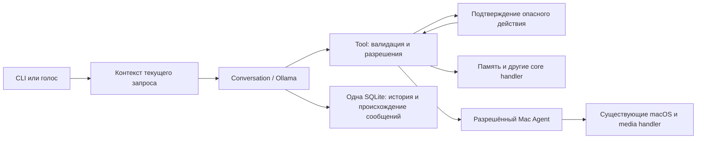

# Чушпан: границы Core Server, Mac Agent и клиентов

Актуализация этапа 5: отдельное приложение/PWA для iPhone/iPad отменено. Будущий
клиент — Apple Shortcuts; ниже сохранены границы Core/Agent, а не план нового UI.
Текущая реализация памяти и ночного сценария: [отчёт](CHUSHPAN_STAGE5_REPORT.md).

Этап 2/13, 30 октября 2026 года. Это подготовка действующего локального проекта
к будущему разделению. Новый сетевой сервер, мобильное приложение, Tailscale и
удалённый транспорт Mac Agent на этом этапе не создаются.

Дополнение этапа 3: [отчёт Mac-команд](CHUSHPAN_STAGE3_REPORT.md),
[контракт персонализации для этапа 5](CHUSHPAN_PERSONALIZATION.md).
Mac Agent получил фиксированные desktop-операции через существующий AX helper.
Capabilities расширены `mac.windows`, `mac.screen`, `mac.files`; прежние grants
сохранены. Клиент не выдаёт себе эти права. Window ID выдаётся исполнителем,
привязан к device/session, живёт 120 секунд и одну операцию; перед действием
повторно сверяются PID, bundle, ordinal/title/identifier/frame и состояние.
Это короткоживущая AX-ссылка, не универсальный стабильный ID окна macOS.
Отдельного удалённого транспорта по-прежнему нет.

Простые подтверждённые результаты системных tools и desktop-операций выводит
код через `Tool.reply`. Свободный текст перед выполнением явно запрошенной команды
удерживается: пропущенный tool call повторяется один раз, затем возвращается
честный отказ. Это не универсальная верификация всех утверждений LLM.

## Что выделено в коде

- **Core Server:** `backend/brain/llm.py`, `conversation.py`, `prompts.py`,
  `backend/memory/store.py`, `backend/tools/registry.py`, `backend/security.py`,
  `backend/config.py`. Здесь модель, единая память, диалоги, политика действий,
  настройки и сценарии. Конструктор `Conversation` уже принимает LLM, store,
  registry и `DeviceContext`; перенос файлов по большим новым пакетам не нужен.
- **Mac Agent:** узкий `MacAgent` Protocol и `LocalMacAgent` в
  `backend/mac_agent.py`. `execute(operation, arguments, context)` принимает
  только зарегистрированные операции. Нет параметра shell/command/script.
  `system_tools` и музыкальные схемы привязаны к Agent через `build_registry`.
  Реализации существующих команд и музыкальные адаптеры сохранены.
- **Клиенты:** CLI chat, локальный голосовой цикл, существующий TypeScript HUD.
  Apple Shortcuts на iPhone/iPad и колонка в будущем используют те же диалоги и память,
  но не импортируют локальные системные handler и не хранят отдельную SQLite.
- **Контекст:** `backend/context.py`. `DeviceContext` содержит `device_id`,
  тип (`mac`, `iphone`, `ipad`, `speaker`, `server`), session ID, серверные
  capabilities, признак проверенной сессии и ID целевого Mac Agent.
  `RequestContext` добавляет текущий текст и уникальный request ID.

Текущий путь запроса:

`Tool.handler` возвращает защищённый `invoke`, поэтому обращение к
зарегистрированному handler напрямую не обходит проверки. Вызов Agent также
требует внутреннего разрешённого dispatch-контекста; знание operation/device ID
не заменяет прохождение gate. Python-код приложения и его зависимости остаются
доверенным кодом: это не sandbox для исполнения произвольного Python.

## Граница доверия устройства

`DeviceContext` — внутренний объект сервера, не формат доверенного клиентского
JSON. Сейчас `DeviceContext.local_mac()` создаёт доверенную локальную сессию
для существующего настольного режима. У проекта пока нет маршрута, который
конструирует её из входящего `device_id` или `authenticated: true`.

Для будущего сетевого endpoint порядок должен быть таким:

1. Проверить токен/сессию и владельца устройства на сервере.
2. Найти зарегистрированное устройство и его grants по серверным данным.
3. Создать внутренний `DeviceContext`; клиентские capabilities не принимать за grants.
4. Выбрать конкретный разрешённый и доступный Agent, затем проверить capability
   (`mac.apps`, `mac.system`, `mac.media`, `mac.personal`).
5. Выполнить обычную валидацию/intent/confirmation и отправить разрешённую операцию.
6. На стороне Agent повторно проверить транспортную аутентификацию, разрешение,
   аргументы и idempotency key до локального действия.

Пример с iPhone: source — авторизованный iPhone, target — отдельно разрешённый
MacBook. Если у source нет `mac.apps`, target отсутствует или Agent недоступен,
«Открой IntelliJ» возвращает отказ. Сервер не выполняет `open -a` у себя.
Для Core Server предусмотрен `build_registry(..., local_mac=False)`:
локальный Agent не подставляется автоматически. Удалённый транспорт пока отсутствует.

Нативный утренний сценарий пока работает только с `LocalMacAgent`; при внешнем
Agent он не создаётся. Это не позволяет будущему серверу незаметно читать свой
EventKit/CoreLocation вместо данных разрешённого Mac. Перед отложенным запуском
музыки повторно проверяется разрешение текущего устройства.

## Политика действий и подтверждения

Политика находится в `backend/security.py`, общая точка выполнения — `Tool.invoke`.

- `safe`: чтение статуса, погода, новости, время, таймеры, метаданные/списки музыки.
  Дополнительный вопрос не нужен. Права на приватные/macOS данные всё равно проверяются.
- `state_change`: открытие приложения, громкость, playback, таймеры, переход в ожидание.
  Нужна явная просьба текущей пользовательницы, но отдельный код не нужен.
- `dangerous`: запись/исправление/удаление факта и явное назначение музыкального
  предпочтения. Выполнение требует отдельного подтверждения.

Системные утилиты чтения статуса остаются безопасными по назначению;
универсального инструмента запуска системных команд нет. Удаление файлов,
выключение Mac, управление окнами/светом на этом этапе не добавлялись.
Автор нового инструмента обязан выбрать корректный риск/intent и ограничения
схемы. Реестр не может угадать побочные действия произвольного доверенного handler.

Опасное действие связывается с названием, нормализованными аргументами,
конкретным описанием результата и контекстом source/device/session. Для удаления
в описание входит существующий факт; подмена его содержания делает старый код
непригодным. В памяти приложения хранится одна ожидающая операция на device/session.

Срок — 90 секунд по монотонным часам. Подтверждение — новое сообщение
`Подтверждаю 1 2 3 4` с показанным кодом; голос принимает и отдельные названия
цифр, например `Подтверждаю код один два три четыре`. Четыре цифры — удобство
подтверждения, не пароль и не замена сетевой аутентификации.

Обычное «да», старый ответ из истории, код другой сессии/устройства и неверный
код не разрешают действие. Новая посторонняя просьба, отмена, reset или истечение
времени отменяют ожидание. Код потребляется до await, поэтому повторный/
параллельный ответ не повторяет действие. Коды не переиспользуются в рамках
одного экземпляра менеджера. При 9000 выданных кодах требуется новая сессия/менеджер.

Запрос подтверждения и проверка ответа выполняются кодом, а не моделью.
В Ollama schemas нет инструмента `confirm` и нет аргумента `approved`.
После появления ожидающего действия остальные вызовы того же batch блокируются.
Операции выполняются последовательно; действует предел восемь вызовов в ответе
и строгий предел `tools.max_rounds` на раунды с исполнением handler.

`forget` дополнительно проверяет прямую просьбу удалить память, однозначно
находит факт и сверяет его номер/содержание с просьбой. Текст сайта, документа,
tool result или старой истории не становится источником разрешения. Эвристика
разбора русского/английского/португальского не является полноценным NLU: сложную
или неясную формулировку может потребоваться переформулировать. Даже после
распознанной просьбы удаление ждёт код, показанный с конкретным фактом.

## Валидация

`backend/tools/validation.py` проверяет используемое подмножество JSON Schema:
объект аргументов, required, точные типы (bool не integer), enum, конечность чисел,
диапазоны, длины строк, управляющие символы, pattern и ограничения пути.
Для существующих инструментов ограничения добавляются при сборке реестра.
`open_app` принимает имя приложения, а не произвольный путь/URL/набор аргументов.

Неизвестные поля отбрасываются до handler для совместимости прежних клиентов;
клиентские `device_id`, `capabilities`, `approved` таким способом не влияют на
полномочия. Schema указывает `additionalProperties:false`. Это не полноценная
реализация всех возможностей JSON Schema. Новый инструмент с файловыми путями
должен дополнительно ограничивать корни/симлинки под свою задачу; общего file tool нет.

## Существующее API и будущий защищённый доступ

Сейчас `GET /` раздаёт HUD, `/ws` передаёт snapshot/события. Клиент может
послать `wake`, `sleep`, `autostart` с boolean и `export`. Чужой browser origin
отклоняется, но отсутствие Origin разрешено для локальных клиентов; отдельной
аутентификации у этого локального WebSocket нет.

Чтобы не выставить этот интерфейс в сеть, `ServerConfig.host` ограничен
`127.0.0.1`/`localhost`. Не открывались порты, публичные endpoints не добавлялись.
HUD-кнопки и отдельные административные CLI-команды остаются локальными
интерфейсами; они не предоставляют LLM универсальный доступ к launchctl или SQLite.
Перед сетевым использованием потребуется аутентифицировать все эти действия.

Назначение будущих маршрутов (проектирование, **сейчас не реализованы**):

- Сообщение: защищённый `POST /api/v1/conversations/{id}/messages`; server-issued
  source/session, request ID/idempotency key, длина/тип сообщения, права на диалог.
- Ответы: авторизованный WebSocket/SSE с порядковыми номерами событий и отменой.
  `/ws` HUD даёт полезный формат событий, но сам по себе не подходит для remote доступа.
- История: защищённый `GET /api/v1/conversations/{id}/messages`, пагинация и проверка владельца.
  Сейчас история доступна через Python `MemoryStore`, не через HTTP.
- Статус: защищённый `GET /api/v1/status`; не раскрывать диалог/персональные данные
  в публичной health probe. Сейчас состояние передаёт локальный HudBus.
- Возможности: защищённый `GET /api/v1/capabilities`, вычисленный сервером для
  конкретного клиента, разрешённого Agent и его доступности; это не список claims клиента.
- Голос: защищённый канал audio chunks/turn IDs, ограничения размера/формата/
  длительности, отмена/разрыв соединения и явное состояние микрофона. Сейчас
  аудио обрабатывается локальным `voice.py`, сетевого audio endpoint нет.

Базовые требования будущего доступа: TLS, pairing/revocation, серверное хранение
сессий/grants, проверки Origin для браузера, rate limits, replay/idempotency,
тайм-ауты Agent и отсутствие автоматического fallback на сервер. Tailscale даёт
сетевую доступность, но сам по себе не заменяет эти проверки приложения.

## Одна память и безопасная миграция

Единственная рабочая БД остаётся `data/jarvis.db`. В `messages` добавлена
аддитивная транзакционная миграция четырёх nullable TEXT колонок: `device_id`,
`device_type`, `session_id`, `request_id`. Старые сообщения остаются с NULL;
их текст, ID, tool traces, факты и `youtube_music` preferences не изменяются.
`recent()`/экспорт сохраняют совместимый формат. Текущие запросы `Conversation`
сохраняют происхождение сообщений; будущие устройства могут писать в те же диалоги.

Миграция проверяется на тестовой старой схеме, сохранением нескольких устройств
в одной БД и на отдельной приватной копии реальной БД. Оригинальная рабочая БД
в ходе наших проверок новой версией MemoryStore не открывалась и не мигрировалась;
миграция применяется при следующем обычном открытии новой версией приложения.
Перед эксплуатацией копию
БД следует хранить приватно. Исправление факта теперь атомарно: удаление старого
и добавление нового откатываются вместе при ошибке вставки.

Финальная read-only сверка обнаружила два новых сообщения в рабочей БД,
открытой существующим Python-процессом. Все прежние строки сохранены, схема
ещё старая. Поэтому байтовая неизменность БД за весь этап не заявляется;
подробности — в [итоговом отчёте](CHUSHPAN_STAGE2_REPORT.md).

Сетевой sync, очередь offline сообщений, распределённая БД, новый сервер памяти
и автоматическая синхронизация файлов — этапы 5–7/13. Их здесь нет.

## Разрешения macOS

Новая команда `python -m backend permissions` читает статусы текущего контекста
запуска без запроса разрешений. Automation проверяется адресно:
`python -m backend permissions --automation com.spotify.client`;
цель не запускается ради проверки. Helper компилируется в приватный временный
каталог и удаляется после выполнения; рабочий `data/` для диагностики не нужен.

Использованы публичные API Apple:
[AXIsProcessTrusted](https://developer.apple.com/documentation/applicationservices/1460720-axisprocesstrusted),
[CGPreflightScreenCaptureAccess](https://developer.apple.com/documentation/coregraphics/cgpreflightscreencaptureaccess()),
[AVCaptureDevice.authorizationStatus](https://developer.apple.com/documentation/avfoundation/avcapturedevice/authorizationstatus(for:)),
[AEDeterminePermissionToAutomateTarget](https://developer.apple.com/documentation/coreservices/3025784-aedeterminepermissiontoautomatet)
с `askUserIfNeeded=false`. Для Screen Recording/AX результат «не предоставлено»
не различает отказ и ещё не выданный доступ. Для незапущенной Automation-цели
возвращается отдельное состояние, а не ложное разрешение.

Диагностика не запрашивает четыре разрешения сразу, не меняет TCC и не обходит
его. Сообщения об ошибках содержат путь в настройки и указывают, что доступ
нужен именно Terminal/Codex/Чушпан.app текущего запуска. Выданное одному
приложению разрешение не доказывает разрешение другому. Отчёт preflight не
заменяет живой проверки микрофона/экрана/музыки после отдельного разрешения.

## Дополнение этапа 4: провайдеры, вложения и Shortcuts

`LLMClient` задаёт общий streaming-интерфейс диалога/инструментов и lifecycle.
`create_llm` выбирает явную Ollama либо GeminiClient/FallbackClient. Chat, voice,
сводка и idle resources используют этот контракт. `bench` остаётся отдельным
диагностическим сравнением локальных Ollama-моделей. Никакого внешнего API не добавлено.

Gemini использует официальный Google Gen AI SDK/Developer API с фиксированным host,
отключённым автоматическим function execution и без встроенных Google tools.
Функции — только декларации общего реестра; авторизация выполняется Python-кодом.
Один полный ответ Gemini буферизуется перед выдачей: частичный/заблокированный/
оборванный ответ не выпускает действия. Подписанные native parts передаются обратно
SDK только внутри текущего tool round и не сохраняются в SQLite. Старые tool traces
превращаются в недоверенные данные без выдуманных thought signatures.

Fallback: gemini-3.8-flash → gemini-3.5-flash → loopback Ollama. Сейчас Google
возвращает для идентификатора 3.5 фактическую model_version gemini-3.6-flash;
запрошенная и фактическая модели логируются без содержимого запроса/ключей.
Переключение до выдачи результата разрешено только при 429/500/502/503/504,
сетевых тайм-аутах/сбоях соединения. Ошибки авторизации/конфигурации, включая
400/401/403/404, не маскируются резервом. По одной попытке каждой модели, SDK
retries отключены, deadline 15 с на облачную попытку. Пустой/ошибочный/достигший
лимита ответ не считается успехом и не запускает следующий резерв.
Выдавшая tool call модель закрепляется за серверным request ID для сохранения
подписанных parts; новый запрос снова начинает с основной модели.
После результата инструмента в текущем запросе новая цепочка через другого
провайдера не запускается автоматически: это могло бы повторить действие.
Prime/warm Gemini не отправляют запросы в фоне и не расходуют квоту.
Отсутствие ключа/ручной проверки Free tier объясняется; SDK не проверяет Billing
проекта сам и приложение не создаёт платёжные аккаунты/не переключает тариф.
Реальный запрос и проверки искусственных сбоев описаны в
[протоколе fallback](CHUSHPAN_GEMINI_FALLBACK.md).

Для облачного провайдера системная инструкция не содержит таблицу facts, история
ограничена восемью сообщениями текущего диалога (настраивается). API-ключ не является
полем Settings, не выводится config/prompt и передаётся только SDK. Помеченные
текстовые секреты/известный ключ/JSON secret-поля фильтруются перед моделью;
это не универсальный классификатор произвольной чувствительной информации.
Сами старые SQLite/экспорты не переписываются фильтром. Явная Ollama сохраняет
прежний контекст памяти; в Gemini нужны точные запросы remember/forget, автоматической
выгрузки всех фактов нет. Поиск релевантной памяти относится к этапу 5.

`ImageInput` содержит временные bytes/MIME/source; доверенный будущий мобильный
транспорт должен проверять source/grants и связывать его с RequestContext.
`VisionService` использует текущий MacDesktop.screenshot или разрешённый выбранный
файл; проверяет формат/размер/пиксели, удаляет метаданные. Анализ проходит **без tools**,
его текст возвращается напрямую. В Gemini-профиле upload ждёт одноразового кода;
`Tool.version` добавляет внутреннюю версию содержимого к fingerprint без чтения хеша
в голосовом подтверждении. Повторная проверка блокирует подмену файла до отправки.
Временный screenshot удаляется в finally; пользовательский файл остаётся на месте.
Это не OCR-редактор секретных пикселей: их нужно убрать до согласия на передачу.

`ShortcutsService` — фиксированные `list`/`run` штатного CLI, отдельная capability
mac.shortcuts и адресный Agent. Конфигурация содержит только вручную разрешённые
имя/UUID/назначение/тип входа; все запуски требуют свежего кода. Изменение реестра
меняет fingerprint. Внутренние действия Shortcut могут измениться при прежнем UUID,
поэтому требуется ручная проверка; произвольный Shortcut не становится безопасным
от одного включения в реестр. Дочернему CLI не передаётся окружение с ключами API.
Вывод недоверенный; после запуска не начинается новый модельный цикл действий.
Ни удалённого запуска на iPhone, ни авторизованного мобильного endpoint пока нет.

## Этап 5: память и фиксированный ночной сценарий

`ProfileMemory` расширяет прежний MemoryStore: facts остаются единственным
хранилищем долговременных записей; preferences — прежним хранилищем настроек.
Источником автоматической записи служит только текущая аутентифицированная реплика,
не LLM/история/страница/картинка. Отобранный контекст ограничен и исключает
чувствительные/устаревшие записи. Character settings имеют тот же источник истины.
Детали миграции/согласия/забывания: [отчёт этапа 5](CHUSHPAN_STAGE5_REPORT.md).

Ночной сценарий — один фиксированный dangerous tool за общим gate и Agent,
а не произвольный интерпретатор сценариев. SQLite lease сериализует экземпляры,
журнал каждого шага записывается до side effect. Заданные UUID/уровни/описание
Shortcut входят в подтверждение. Длительный sleep-watcher имеет закрытый порт
запуска с проверкой Agent ticket; LLM этот порт напрямую вызвать не может.

Для будущего Apple Shortcut на iPhone/iPad не требуется отдельное приложение.
Предлагается HTTPS API внутри частной сети с отдельной аутентификацией: pairing-код,
показанный на Mac, открывает короткую scoped session. Токен — только в переменных
текущего запуска команды, не в экспортируемом тексте; Gemini API key — только
в серверном окружении. Сервер выдаёт device/session/grants и проверяет revoke,
request ID, размеры/скорость запросов. Повтор при обрыве возвращает прежний результат,
не повторяет Mac-действие. Опасный запрос требует отдельного связанного кода.
Tailscale identity не заменяет эту проверку; существующий HUD/WebSocket не публикуется.
Это контракт будущего этапа 7: API/порты/токены сейчас не создавались.
