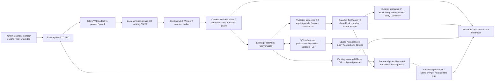

# Чушпан: Voice & Intelligence Engine 2.0

Работа выполнена 2026-11-06 поверх существующей архитектуры. Исходная ревизия
`dcf7117`; [аудит и план](VOICE_ENGINE_2_AUDIT.md) сохранены до реализации.
Дизайн и интерфейс не менялись. SQLite, интеграции, провайдеры, пользовательские
настройки и пользовательские данные сохранены. Платные API не добавлялись.

## Архитектура после изменений



## Реализация по модулям

- `backend/audio/capture.py`: эпоха потока отсекает callback закрытого входа;
  смена микрофона и stop очищают уже накопленные кадры. Ошибка stop не мешает
  close. Watchdog повторяет восстановление с задержкой до 5 с до возвращения
  устройства; отмена приложения прерывает ожидание. Реальное отключение USB/BT
  микрофона не тестировалось.
- `backend/audio/vad.py`: адаптивная пауза ограничена относительно заданного
  пользователем значения. Длинная речь и уже наблюдавшиеся паузы получают
  дополнительное время; нижняя граница, преролл и гистерезис сохранены.
- `backend/voice.py`: обрезанная по максимальной длительности запись не
  исполняется. HUD предлагает разделить команду. Интервалы wake/VAD относятся
  к текущему событию; время старой активации не переносится на следующие реплики.
- `backend/audio/sentences.py`: длинный поток без пунктуации выдаётся на границах
  слов примерно по 240 символов. Сохраняются все слова, URL, литералы,
  сокращения и инициалы. Одно очень длинное слово/URL не режется принудительно.
- `backend/audio/tts.py`: готовность PCM отделена от первого успешного write
  в аудиопоток. Системный `say` сериализован и при отмене завершает и дожидается
  своего процесса; ненулевой код возврата считается ошибкой. Тесты не запускали
  настоящий `say`. Silero/Piper продолжают использовать существующие прогрев,
  очередь, синтез следующей фразы, AEC-reference и отмену.
- `backend/audio/russian.py`: встроенное **Чу́шпан** применяется к речевой копии;
  пользовательский словарь имеет приоритет. Нормализация числительных, дат,
  единиц, английских названий и смешанной речи сохранена. История и текст HUD
  остаются исходными.
- `backend/intents.py`: строгий `ControlPlan.mode` со значениями sequence/parallel,
  обычное «и» сохраняет последовательность. Явное «одновременно» разрешает
  независимые ветки; «затем»/«потом» задают порядок, включая повторное изменение
  одного устройства. Неизвестная часть или конфликт отклоняют весь план до
  отправки команд. Все начатые параллельные ветки завершаются или отменяются
  вместе с владельцем, результаты сохраняются в порядке исходного запроса.
  Повтор того же request ID не запускает эффекты снова.
- `backend/tools/registry.py`: домены блокировок вынесены в общий каталог для
  исполнения и проверки параллельного плана. Неверный прочитанный уровень
  громкости/яркости не считается успехом даже при общем флаге подтверждения.
- `backend/memory/profile.py`: явные нечувствительные сообщения вида
  «Сегодня я завершила проект…» становятся episode с источником текущей
  пользовательской реплики, confidence=0.9 и сроком из `temporary_days`.
  Это сообщение пользователя о событии, не внешняя проверка его истинности.
  Неуверенные высказывания, цитаты, секреты, отрицания и чувствительные сведения
  не извлекаются. Политики ask/off и исключение episode соблюдаются.
  Записи с confidence ниже 0.75 не входят в автоматический контекст.
- `backend/memory/library.py`: явное подтверждение воспоминания поднимает
  confidence до 1. Исправление, удаление, проектная изоляция, журнал доступа
  и запрет повторного автоизвлечения удалённого содержания сохранены.
- `backend/latency.py`, `backend/brain/conversation.py`: новые метрики добавлены
  в `pipeline_metrics`; прежний объект `metrics` сохранён для совместимости.
  Исправлено вычитание смещения конца пользовательской речи. Routing измеряется
  и для раннего маршрута реестра устройств. TTFT учитывает первый токен,
  включая reasoning, если провайдер его сообщает.
- `scripts/benchmark_voice_engine.py`: воспроизводимый CPU-стенд, который
  использует настоящий splitter/VAD/компилятор/проверки инструментов и явно
  искусственные задержки транспорта. Никакого микрофона или вывода звука.

## Девять показателей

Все длительности — секунды, монотонные часы. При отсутствии стадии возвращается
`null`, а не вымышленный ноль. В сохранённых `request_traces.data.pipeline_metrics`:

- Wake: `wake_s` — время распознавания активации; дополнительно
  `wake_activation_s` — от конца речи до принятия Whisper-активации.
- VAD: `vad_onset_s` — длительность подтверждения начала в кадрах,
  `vad_endpoint_s` — ожидание тишины до завершения сегмента.
- STT: `stt_s`.
- Routing: `routing_s` — локальные распознаватели намерения, без исполнения.
- LLM TTFT: `llm_first_token_s`; `llm_first_text_s` отдельно от reasoning.
- LLM duration: `llm_total_s`; потребительское ожидание очереди учитывается отдельно.
- Tools: `tool_execution_s` — сумма интервалов исполнения; параллельная сумма
  может быть больше реального времени выполнения всего плана.
- TTS TTFA: `tts_first_audio_s` — от готовой первой фразы до успешного write;
  `tts_first_pcm_s` — синтез до готового PCM. Ни одна из метрик не измеряет
  физический акустический выход из динамика.
- Total: `total_response_s`; отдельно speech_end → audio и speech_end → completed.

## Замеры до и после

Сырые диагностические JSON сохранены локально в `data/latency-benchmarks/` и
`data/diagnostics/voice-check.json`, вне Git. Данные этой серии — синтетические.
Числа ниже не обещают скорость в реальном помещении.

- Маршрутизация, настоящий Conversation, моки LLM/транспорта, 100 проходов:
  p50 **1.361 → 1.406 мс**, p95 **1.943 → 2.073 мс**. Обращений к модели **0 → 0**.
  Распределение сохранено: 80 completed, 10 rejected, 10 failed. Последняя группа
  — сценарий с намеренно неподключённой музыкальной интеграцией в безопасном
  стенде, а не 10 новых ошибок продукта. Эта выборка не показывает ускорения
  уже существующего Fast Path.
- Локальный MLX STT на тех же пяти синтетических фразах по три раза:
  p50 **494.670 → 504.314 мс**, p95 **508.698 → 515.804 мс**. Все 15 декодирований
  в каждой серии имеют акустическую уверенность декодера. Ускорение или улучшение
  WER человеческой речи не доказано; STT не заменялся.
- Непунктуированный текст, настоящий splitter: до изменения первый фрагмент
  появлялся только при flush всего текста. После — около **242 входных символов**,
  всего **6 фрагментов**, без потери слов. Это измерение буферизации текста,
  не время настоящей модели или звука.
- Длинная команда, синтетические вероятности VAD, стандартный порог 1200 мс:
  endpoint **1216 → 1408 мс**. Дополнительные 192 мс дают место внутренней паузе;
  короткая команда по-прежнему использует заданный порог.
- Два независимых инструмента с искусственным ожиданием по 25 мс, по 10 проходов:
  медиана sequence **54.825 мс**, explicit parallel **27.862 мс** (примерно −49%).
  Это парное сравнение режимов нового планировщика; оно не измеряет BLE/Safari.
- Настоящие локальные **qwen3:8b + Silero eugene**, один нейтральный вопрос,
  по три прохода, все ответы завершены. Первое обращение: первый текст
  **4.453 → 2.515 с**, первый PCM **5.404 → 3.502 с**. Прогретые два прохода:
  медиана TTFT **0.037 → 0.048 с**, медиана первого PCM **1.002 → 1.035 с**.
  Общие времена генерации до: **6.411 / 2.002 / 1.788 с**, после:
  **5.540 / 2.773 / 1.721 с**. Кэш промпта и длина генерации различаются:
  первое обращение нельзя выдавать за доказанное ускорение. Двух прогретых
  наблюдений недостаточно для p95 или вывода о регрессии.
- Живые wake/VAD, акустический TTFA и полный голосовой отклик в помещении:
  **не измерены**. Для этой части нужны отдельные разрешения на микрофон и звук.

## Проверки

Исходный полный набор: **2442 passed**, один тест Unix-сокета прошёл отдельно вне
sandbox. Первый полный прогон после изменений: **2490 passed**. Финальный прогон
после уточнения отмены/восстановления: **2496 passed**, 87.56 с.
Ruff прошёл для всего проекта; проверка форматирования: **369 files already formatted**.

Новые регрессии в `tests/test_voice_engine_{audio,plans,memory}.py` проверяют:
паузы, шум, восстановление после более трёх ошибок входа, старые callback,
обрезанную команду, поток без пунктуации, сохранение литералов, ударение,
отмену системного TTS, отсутствие ложного аудио при готовом PCM, параллелизм,
конфликты, ошибки, частичный результат, отмену и повтор request ID,
перезапуск SQLite, источник/доверие/expiry, удаление и конфиденциальность памяти.
Существующие тесты покрывают Fast Path, неполные фразы, follow-up без имени,
barge-in, echo, недоступность устройств, IF/ELSE, delay и отмену сценариев.

Реальный офлайн replay VAD → Whisper → VoiceLoop:

- Тишина, стационарный шум, синтетическая фоновая речь, WAV кашля и WAV щелчка:
  **0 принятых запросов** в каждом из пяти случаев.
- Синтетическое «Эй, Чушпан, что такое радуга?»:
  **1 принятый запрос**, одна тестовая реакция, возврат к listening.
- VAD и Whisper настоящие; ответ и его вывод заменены беззвучным приёмником.
  Микрофон, динамики, телевизор, BLE, Safari и внешние сервисы не использовались.
  Шести файлов недостаточно для статистики ложных активаций в комнате.

## Запуск и повторная проверка

Из корня проекта с установленными зависимостями и уже загруженными моделями:

```bash
.venv/bin/python -m pytest -q
.venv/bin/ruff check .
.venv/bin/ruff format --check .
.venv/bin/python -m scripts.benchmark_voice_engine --output data/latency-benchmarks/engine-repeat.json --runs 10
.venv/bin/python -m backend.bench_response --routing-only --label sample --runs 10
HF_HUB_OFFLINE=1 TRANSFORMERS_OFFLINE=1 .venv/bin/python -m backend.bench_response --stt --label sample --runs 3
HF_HUB_OFFLINE=1 TRANSFORMERS_OFFLINE=1 .venv/bin/python -m backend.bench_response --label sample --cases explanation --runs 3
HF_HUB_OFFLINE=1 TRANSFORMERS_OFFLINE=1 .venv/bin/python -m backend voice-check --decode
```

Последние три команды используют локальные модели и CPU/GPU, не записывают
микрофон и не воспроизводят звук. Для MLX нужен доступ к Metal; запрет sandbox
не является ошибкой распознавания. Ollama должна быть запущена, модель —
установлена заранее. Реальные устройства в `bench_response` заменены стендом.

Для обычной работы: `.venv/bin/python -m backend voice --no-briefing`.
Эта команда уже открывает микрофон и может воспроизводить звук; в ходе этой
задачи она не запускалась. Для ручной приёмки с разрешением на нужные устройства:

1. «Эй, Чушпан, сколько времени?» → ответ, следом вопрос без нового обращения.
2. Длинная просьба с паузой внутри → одна завершённая команда.
3. Во время ответа «Чушпан, стоп» → остановка; собственная озвучка не активирует
   новый запрос. Nameless barge-in требует соответствующей настройки.
4. «Одновременно сделай ленту розовой и яркость экрана 30%» → независимые ветки,
   в ответе различаются отправка и фактическое подтверждение.
5. «Сделай яркость экрана 20%, затем сделай яркость экрана 30%» → строгий порядок.
6. «Яркость 30%» → уточнение устройства при отсутствии свежего контекста.
7. В сценариях собрать IF/ELSE, delay и parallel; отменить выполнение во время
   delay. Уже отправленные действия не откатываются.
8. «Сегодня я завершила проект Чушпан» → episode по политике памяти; изменить
   или удалить запись в библиотеке и проверить её отсутствие в контексте.
9. Сменить/отключить микрофон, затем вернуть; проверить listening и новые кадры.

## Оставшиеся ограничения

- Whisper распознаёт целые VAD-сегменты. Потоковая диктовка с частичными
  гипотезами не добавлялась; решения о wake остаются консервативными.
- whisper.cpp рассмотрен как кандидат по первичным документам в аудите.
  Сравнительного запуска whisper.cpp здесь не было; замена MLX не обоснована.
- Свободная фраза с IF/ELSE, задержками или смешанными группами не превращается
  в произвольную программу. Для них используется существующий редактор и
  проверенная схема сценариев. В обычном Fast Path сложная неоднозначность
  приводит к уточнению до эффектов.
- Запущенный сценарий после перезапуска не повторяет неизвестный эффект;
  живые задержки прерываются. Постоянные расписания сценариев сохраняются.
  Кэш повторов ControlSession действует в текущем процессе; новая сессия
  не получает старые полномочия на управление устройством.
- Подтверждение write аудиодрайвером не доказывает, что звук физически слышен.
  PCM-стенд не измеряет динамики, эхо помещения или человеческое произношение.
- Confidence — служебный уровень доверия к источнику, не калиброванная
  вероятность истинности. Автоизвлечение событий намеренно ограничено шаблонами.
- Expiry исключает временную память из поиска и контекста, но не стирает
  разговоры и резервные копии. Физическое удаление выполняется только явным
  действием пользователя; существующие данные автоматически не очищались.
- Установленный `.app` не пересобирался и не заменялся: проверен исходный код
  и локальные модели. Запуск установленной копии требует отдельной сборки.
