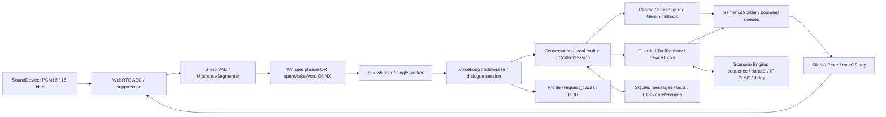

# Voice & Intelligence Engine 2.0 — аудит исходников

Дата: 2026-11-06. Исходная ревизия: `dcf7117`. Проверена локальная `main`,
remote `origin` указывает на JelizavetaKirsanova/chushpan. Пользовательские настройки,
базы и ключи не включаются в этот отчёт. Это аудит кода, а не запись живого диалога.

## Фактическая архитектура до изменений

Ветка Whisper-активации использует результат того же распознавания для команды
в одной фразе; второй STT не нужен. ONNX-путь существует для установленной модели,
но наличие обученной русской модели по имени файла не предполагается.

## Владельцы компонентов

- Вход, смена микрофона, watchdog: `backend/audio/capture.py`.
- VAD, преролл, гистерезис, паузы, лимит записи: `backend/audio/vad.py`,
  `backend/config.py:VADConfig`.
- Локальный STT, акустическая уверенность, фильтр галлюцинаций:
  `backend/audio/stt.py`; wake: `backend/audio/wakeword.py`,
  `backend/voice.py:_check_wake_phrase`.
- Адресат, continuation, barge-in, подавление собственного голоса:
  `backend/addressee.py`, `backend/dialogue.py`, `backend/audio/activity.py`,
  `backend/audio/aec.py`, `backend/voice.py:VoiceLoop`.
- LLM: `backend/brain/llm.py` (Ollama), `providers.py` (Gemini / fallback),
  `conversation.py` (локальные маршруты, контекст, поток ответов).
- Fast Path: `backend/local_commands.py`, `backend/intents.py`,
  `backend/music.py`, `backend/devices/service.py`, `backend/cinema/commands.py`.
- Инструменты: `backend/tools/registry.py`, `validation.py`,
  `backend/security.py`, `backend/mac_agent.py`; интеграции сохранены.
- Планировщик: `backend/automation/{models,capabilities,engine,service}.py`.
  Уже есть строгая схема, sequence, parallel, IF/ELSE, delay, расписания,
  отмена задач, журнал шагов, проверки разрешений и блокировки ресурсов.
- Память: `backend/memory/{store,profile,library}.py`,
  `backend/brain/followups.py`, `backend/context.py`.
  Уже есть история, сессии, предпочтения, категории episode/habit, FTS5,
  проекты, источники, confidence, подтверждение, исправление, удаление,
  запрет восстановления удалённого факта и политика приватности.
- TTS: `backend/audio/{tts,sentences,russian,foreign,abbreviations}.py`,
  словарь произношений; оригинал в истории не заменяется речевой копией.
- Диагностика: `backend/{latency,performance,latency_check,bench_response,
  stt_check,voice_check,wake_test}.py`; трассы без текста запросов.

## Подтверждённые проблемы и план исправлений

1. `UtteranceSegmenter.endpoint_frames`: верхняя граница 1100 мс ниже штатного
   `silence_ms=1200`, поэтому адаптация длинной речи выключена фактически.
   Исправить ограниченную адаптацию относительно пользовательского порога;
   проверить длинные команды и паузы синтетическими кадрами.
2. `Microphone.stop`: исключение `stop()` препятствует `close()` и очистке
   ссылки на поток. Старый callback после переподключения может попасть в новую
   очередь. Добавить идентичность потока и гарантированное освобождение;
   тестировать только поддельный SoundDevice.
3. `SentenceSplitter` ждёт пунктуацию до конца непунктуированного ответа;
   `synthesis_chunks` ограничивает вход уже после ожидания. Добавить ограничение
   накопления на безопасной границе слов, защищая URL, числа и сокращения.
4. Fast Path выполняет составные команды последовательно даже при явно
   независимых действиях. Добавить явное «одновременно», сохранив обычный
   последовательный режим и отклоняя конфликтующие ресурсы до первого эффекта.
5. Все девять требуемых показателей не представлены единым набором: есть
   отдельные интервалы, но отсутствуют сводные wake/VAD/routing, а итоговая
   задержка от конца речи должна вычитать смещение `user_speech_end`.
   Добавить совместимые метрики с `null` при отсутствии измерения.
6. Автоизвлечение фактов ограничено предпочтениями/профилем/проектами;
   категории событий есть, но прямое заявление о событии не извлекается.
   Добавить консервативные шаблоны событий с источником, confidence и сроком
   актуальности; не извлекать из ответов LLM или результатов инструментов.
7. Имя Чушпан не имеет гарантированного встроенного ударения в речевой копии.
   Добавить дефолт с сохранением пользовательского словаря.
8. Обрезка по `max_utterance_s` может отдать неполную команду исполнителю.
   Требуется отказ от исполнения с понятным предложением разделить запрос.

Прогрев STT/TTS/локальной LLM, потоковая генерация, очереди с backpressure,
отмена ответов и TTS, диалог без повторного wake, AEC и защита разрешений
уже реализованы. Их нужно регрессионно проверить, а не создавать второй конвейер.

## Исходные проверки и границы измерений

- 425 целевых тестов: **passed**, 6.89 с.
- Запущен полный набор pytest; итог будет включён в отчёт после завершения.
- `backend.bench_response --routing-only --label before --runs 10`:
  100 проходов настоящих Conversation и маршрутизации; LLM и транспорт
  инструментов заменены. Сырой JSON остаётся в `data/latency-benchmarks/`.
- GPU-замеры синтетического STT разрешены отдельно. Sandbox без Metal
  не подходит для измерения MLX: ошибка отсутствия устройства не является
  измерением скорости. Реальные микрофон, динамики и устройства не проверялись.
- Живые wake, VAD, точность распознавания человеческой речи и акустическое
  прерывание не измерены. Нельзя выдавать длительность mock-handler за скорость
  Bluetooth, Safari, реального TTS или LLM.

## Локальные альтернативы STT

whisper.cpp поддерживает Apple Silicon, Metal, Core ML и примеры потокового
распознавания; это кандидат для отдельного A/B, а не доказанное ускорение.
Первичные источники: [whisper.cpp](https://github.com/ggml-org/whisper.cpp/blob/master/README.md),
[MLX Whisper benchmark](https://github.com/ml-explore/mlx-examples/blob/main/whisper/benchmark.py).
Сравнивать нужно одну модель/квантизацию, одинаковые WAV, холодный и тёплый запуск,
WER/CER, ошибочные wake на шуме, энергопотребление и время восстановления.
Без улучшения скорости **и** приемлемой точности существующий MLX не заменяется.
Другие локальные модели и системный STT требуют отдельной проверки русского языка,
лицензии, работы без сети и совместимости с текущей macOS.
